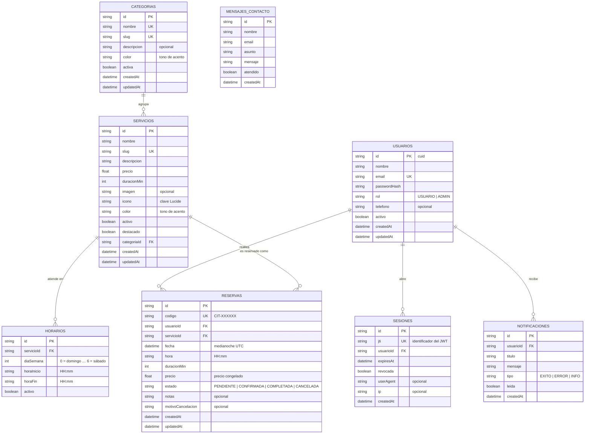

# Base de datos — AgendaFlow

Modelo de datos de AgendaFlow, definido sobre un motor **relacional** (PostgreSQL en producción,
SQLite en desarrollo local) gestionado con **Prisma ORM**.

- **Esquema maestro:** [`prisma/schema.prisma`](../prisma/schema.prisma) — fuente de verdad única.
- **Esquema de desarrollo:** `prisma/schema.sqlite.prisma` — se **genera automáticamente**
  desde el anterior mediante `node scripts/generate-sqlite-schema.mjs`.
- **Migraciones de producción:** [`prisma/migrations/`](../prisma/migrations) (SQL de PostgreSQL).
- **Datos de demostración:** [`prisma/seed.ts`](../prisma/seed.ts).

---

## Índice

1. [Diagrama entidad-relación](#diagrama-entidad-relación)
2. [Descripción de las entidades](#descripción-de-las-entidades)
3. [Relaciones](#relaciones)
4. [Claves, índices y constraints](#claves-índices-y-constraints)
5. [Catálogos y valores controlados](#catálogos-y-valores-controlados)
6. [Decisiones de diseño](#decisiones-de-diseño)
7. [Migraciones](#migraciones)
8. [Datos de demostración](#datos-de-demostración)
9. [Consultas útiles](#consultas-útiles)
10. [Copias de seguridad](#copias-de-seguridad)

---

## Diagrama entidad-relación



> `MENSAJES_CONTACTO` no tiene foreign keys: es una bandeja de entrada independiente del
> registro de usuarios, ya que puede recibir mensajes de visitantes sin cuenta.

---

## Descripción de las entidades

### `usuarios`

Raíz del modelo. Almacena las cuentas de la plataforma.

| Columna | Tipo | Restricciones | Descripción |
| --- | --- | --- | --- |
| `id` | `text` | PK, `cuid()` | Identificador único. |
| `nombre` | `text` | — | Nombre visible (3–80 caracteres, validado en la capa de entrada). |
| `email` | `text` | **UNIQUE**, `NOT NULL` | Correo normalizado a minúsculas. |
| `passwordHash` | `text` | `NOT NULL` | Hash **bcrypt** (coste 12). Nunca se almacena la contraseña. |
| `rol` | `text` | `NOT NULL`, por defecto `USUARIO` | `USUARIO` o `ADMIN`. |
| `telefono` | `text` | opcional | Contacto. |
| `activo` | `boolean` | por defecto `true` | Una cuenta desactivada no puede iniciar sesión. |
| `createdAt` / `updatedAt` | `timestamp` | `NOT NULL` | Auditoría. |

Índices: `@@index([rol])`, `@@index([activo])`.

### `sesiones`

Registro de los tokens emitidos. Permite **revocar** una sesión concreta (al cerrar sesión, al
cambiar el rol o al desactivar la cuenta) sin esperar a que expire el JWT.

| Columna | Tipo | Restricciones | Descripción |
| --- | --- | --- | --- |
| `id` | `text` | PK | Identificador. |
| `jti` | `text` | **UNIQUE** | Identificador único del token (claim `jti` del JWT). |
| `usuarioId` | `text` | FK → `usuarios.id` `ON DELETE CASCADE` | Propietario de la sesión. |
| `expiresAt` | `timestamp` | `NOT NULL` | Caducidad del token. |
| `revocada` | `boolean` | por defecto `false` | Si es `true`, el token deja de ser válido. |
| `userAgent` / `ip` | `text` | opcional | Metadatos de auditoría. |
| `createdAt` | `timestamp` | `NOT NULL` | Emisión. |

Índices: `@@index([usuarioId])`.

### `categorias`

Agrupación de servicios. Es el primer **filtro combinable** del catálogo (RF-03).

| Columna | Tipo | Restricciones | Descripción |
| --- | --- | --- | --- |
| `id` | `text` | PK | Identificador. |
| `nombre` | `text` | **UNIQUE** | Nombre visible. |
| `slug` | `text` | **UNIQUE** | Identificador en la URL. |
| `descripcion` | `text` | opcional | Descripción. |
| `color` | `text` | por defecto `indigo` | Tono de acento usado en la interfaz. |
| `activa` | `boolean` | por defecto `true` | Permite ocultar una categoría sin borrar sus servicios. |

### `servicios` — *entidad principal (RF-02)*

| Columna | Tipo | Restricciones | Descripción |
| --- | --- | --- | --- |
| `id` | `text` | PK | Identificador. |
| `nombre` | `text` | `NOT NULL` | Nombre del servicio. |
| `slug` | `text` | **UNIQUE** | URL pública `/servicios/[slug]`. |
| `descripcion` | `text` | `NOT NULL` | Descripción (20–1200 caracteres). |
| `precio` | `float` | `NOT NULL` | Importe en la moneda de la aplicación. |
| `duracionMin` | `int` | por defecto `30` | Duración en minutos (múltiplo de 15, 15–480). |
| `imagen` | `text` | opcional | Reservado para imágenes propias. La interfaz usa iconos SVG. |
| `icono` | `text` | por defecto `calendar` | Clave del icono Lucide. |
| `color` | `text` | por defecto `indigo` | Tono de acento de la tarjeta. |
| `activo` | `boolean` | por defecto `true` | **Baja lógica**: los servicios dados de baja desaparecen del catálogo pero conservan su histórico. |
| `destacado` | `boolean` | por defecto `false` | Destaca el servicio en la portada. |
| `categoriaId` | `text` | FK → `categorias.id` `ON DELETE RESTRICT` | Categoría a la que pertenece. |
| `createdAt` / `updatedAt` | `timestamp` | `NOT NULL` | Auditoría. |

Índices: `@@index([categoriaId])`, `@@index([activo])`, `@@index([destacado])`.

> `ON DELETE RESTRICT` impide borrar una categoría que todavía tiene servicios: primero hay que
> reasignarlos o darlos de baja.

### `horarios`

Franjas de atención semanales. Son la base del calendario (RF-04).

| Columna | Tipo | Restricciones | Descripción |
| --- | --- | --- | --- |
| `id` | `text` | PK | Identificador. |
| `servicioId` | `text` | FK → `servicios.id` `ON DELETE CASCADE` | Servicio al que pertenece. |
| `diaSemana` | `int` | `NOT NULL` | `0` = domingo … `6` = sábado (convención ISO-8601). |
| `horaInicio` | `text` | `NOT NULL` | `HH:mm`. |
| `horaFin` | `text` | `NOT NULL` | `HH:mm`. |
| `activo` | `boolean` | por defecto `true` | Permite desactivar una franja sin borrarla. |

Constraint único: `@@unique([servicioId, diaSemana, horaInicio])` — evita duplicar la misma
franja el mismo día.

### `reservas`

Citas reservadas (RF-04).

| Columna | Tipo | Restricciones | Descripción |
| --- | --- | --- | --- |
| `id` | `text` | PK | Identificador. |
| `codigo` | `text` | **UNIQUE** | Código legible (`CIT-XXXXXX`) que se muestra al usuario. |
| `usuarioId` | `text` | FK → `usuarios.id` `ON DELETE CASCADE` | Quién reserva. |
| `servicioId` | `text` | FK → `servicios.id` `ON DELETE CASCADE` | Qué se reserva. |
| `fecha` | `date` | `NOT NULL` | Día de la cita (medianoche UTC). |
| `hora` | `text` | `NOT NULL` | Hora de inicio `HH:mm`. |
| `duracionMin` | `int` | `NOT NULL` | Duración congelada en el momento de la reserva. |
| `precio` | `float` | `NOT NULL` | Precio congelado (no cambia si luego se edita el servicio). |
| `estado` | `text` | por defecto `PENDIENTE` | `PENDIENTE`, `CONFIRMADA`, `COMPLETADA`, `CANCELADA`. |
| `notas` | `text` | opcional | Comentario del usuario (máx. 500 caracteres). |
| `motivoCancelacion` | `text` | opcional | Motivo registrado al cancelar. |
| `createdAt` / `updatedAt` | `timestamp` | `NOT NULL` | Auditoría. |

**Índice clave (único parcial)**

```sql
CREATE UNIQUE INDEX "reservas_hueco_activo"
  ON "reservas" ("servicioId", "fecha", "hora")
  WHERE "estado" IN ('PENDIENTE', 'CONFIRMADA');
```

Es la garantía real de que **no se puede sobre-reservar un hueco**: la restricción la impone el
motor de la base de datos, no la aplicación. Si dos usuarios pulsan "Reservar" en el mismo
segundo, una de las dos inserciones falla con `P2002` y la interfaz muestra un aviso.

Al ser **parcial** solo cubre las citas activas: cuando una cita se cancela su hueco vuelve a
estar libre y se puede volver a reservar, mientras la cita cancelada se conserva en el historial.
La aplicación y el índice comparten exactamente el mismo criterio (`PENDIENTE` y `CONFIRMADA` son
las únicas citas que bloquean un hueco), de modo que la agenda nunca ofrece un horario que luego
se rechace con un `409`.

> El índice parcial no se puede expresar en el esquema de Prisma: en PostgreSQL lo crea la
> migración [`20260103000000_indice_parcial_reservas`](../prisma/migrations/20260103000000_indice_parcial_reservas/migration.sql)
> y en SQLite lo aplica el script [`scripts/crear-indices.mjs`](../scripts/crear-indices.mjs)
> (`npm run db:push`).

Índices: `@@index([servicioId, fecha])`, `@@index([usuarioId, fecha])`, `@@index([estado])`.

### `notificaciones`

Avisos mostrados al usuario (RF-05).

| Columna | Tipo | Restricciones | Descripción |
| --- | --- | --- | --- |
| `id` | `text` | PK | Identificador. |
| `usuarioId` | `text` | FK → `usuarios.id` `ON DELETE CASCADE` | Destinatario. |
| `titulo` | `text` | `NOT NULL` | Encabezado breve. |
| `mensaje` | `text` | `NOT NULL` | Texto del aviso. |
| `tipo` | `text` | por defecto `INFO` | `EXITO`, `ERROR`, `INFO`. |
| `leida` | `boolean` | por defecto `false` | Estado de lectura. |
| `createdAt` | `timestamp` | `NOT NULL` | Emisión. |

Índice: `@@index([usuarioId, leida])`.

### `mensajes_contacto`

Bandeja de entrada del formulario de contacto.

| Columna | Tipo | Restricciones | Descripción |
| --- | --- | --- | --- |
| `id` | `text` | PK | Identificador. |
| `nombre` | `text` | `NOT NULL` | Remitente. |
| `email` | `text` | `NOT NULL` | Correo de respuesta. |
| `asunto` | `text` | `NOT NULL` | Asunto. |
| `mensaje` | `text` | `NOT NULL` | Contenido. |
| `atendido` | `boolean` | por defecto `false` | Marca de processed. |
| `createdAt` | `timestamp` | `NOT NULL` | Recepción. |

Índice: `@@index([atendido])`.

---

## Relaciones

| Origen | Destino | Tipo | Integridad referencial | Regla de borrado |
| --- | --- | --- | --- | --- |
| `usuarios` | `sesiones` | 1:N | `usuarioId` → `usuarios.id` | `CASCADE` |
| `usuarios` | `reservas` | 1:N | `usuarioId` → `usuarios.id` | `CASCADE` |
| `usuarios` | `notificaciones` | 1:N | `usuarioId` → `usuarios.id` | `CASCADE` |
| `categorias` | `servicios` | 1:N | `categoriaId` → `categorias.id` | `RESTRICT` |
| `servicios` | `horarios` | 1:N | `servicioId` → `servicios.id` | `CASCADE` |
| `servicios` | `reservas` | 1:N | `servicioId` → `servicios.id` | `CASCADE` |

**Por qué `CASCADE` en `servicios → reservas`:** si una cita hace referencia a un servicio, ese
servicio no puede desaparecer sin dejar citas huérfanas. La aplicación lo evita en la práctica:
`eliminarServicio()` comprueba primero que no existan reservas y, en caso contrario, rechaza la
operación con un `409` y ofrece la **baja lógica** como alternativa.

**Por qué `RESTRICT` en `categorias → servicios`:** evita el borrado accidental de una categoría
entera con todos sus servicios ya cargados en las reservas.

---

## Claves, índices y constraints

| Tabla | Constraint | Tipo | Propósito |
| --- | --- | --- | --- |
| `usuarios` | `email` | UNIQUE | Un correo = una cuenta. |
| `sesiones` | `jti` | UNIQUE | Identificador de token inequívoco. |
| `categorias` | `nombre`, `slug` | UNIQUE | Identidad y URL de la categoría. |
| `servicios` | `slug` | UNIQUE | URL pública del servicio. |
| `horarios` | `(servicioId, diaSemana, horaInicio)` | UNIQUE | No duplicar franjas. |
| `reservas` | `codigo` | UNIQUE | Código de cita único. |
| `reservas` | `(servicioId, fecha, hora)` **WHERE estado IN ('PENDIENTE','CONFIRMADA')** | UNIQUE parcial | **Anti-sobre-reserva** de los huecos activos; una cita cancelada libera su horario. |

### Índices secondary

| Tabla | Índice | Consulta que acelera |
| --- | --- | --- |
| `usuarios` | `(rol)` | Filtrar administradores. |
| `usuarios` | `(activo)` | Listar cuentas activas. |
| `sesiones` | `(usuarioId)` | Revocar las sesiones de un usuario. |
| `servicios` | `(categoriaId)` | Filtro por categoría. |
| `servicios` | `(activo)` | Catálogo público. |
| `servicios` | `(destacado)` | Servicios destacados de la portada. |
| `horarios` | `(servicioId)` | Cargar las franjas de un servicio. |
| `reservas` | `(servicioId, fecha)` | Calcular la disponibilidad de un hueco. |
| `reservas` | `(usuarioId, fecha)` | Agenda del usuario. |
| `reservas` | `(estado)` | Métricas del panel. |
| `notificaciones` | `(usuarioId, leida)` | Centro de notificaciones. |
| `mensajes_contacto` | `(atendido)` | Bandeja de mensajes pendientes. |

---

## Catálogos y valores controlados

| Campo | Valores permitidos | Validación |
| --- | --- | --- |
| `usuarios.rol` | `USUARIO`, `ADMIN` | `ROLES` en `src/lib/constants.ts` + Zod. |
| `reservas.estado` | `PENDIENTE`, `CONFIRMADA`, `COMPLETADA`, `CANCELADA` | `ESTADOS_RESERVA` + Zod. |
| `notificaciones.tipo` | `EXITO`, `ERROR`, `INFO` | `TIPOS_NOTIFICACION`. |
| `servicios.color`, `categorias.color` | `indigo`, `violet`, `sky`, `emerald`, `amber`, `rose`, `teal`, `orange` | `COLORES` + Zod. |
| `horarios.diaSemana` | `0`–`6` (domingo → sábado) | Zod (`int().min(0).max(6)`). |
| `servicios.icono` | Clave de `lucide-react` | Lista blanca en `src/lib/tema.ts`. |
| `servicios.duracionMin` | 15–480, múltiplo de 15 | Zod (`.refine(v => v % 15 === 0)`). |

> **Por qué se guardan como `String` y no como `enum` de Prisma:** los `enum` nativos de Prisma
> generan tipos de base de datos que **no existen en SQLite**, y el proyecto usa SQLite en
> desarrollo. Guardarlos como `String` mantiene un único esquema válido en ambos motores, y la
> validación estricta se aplica en la capa Zod + en los catálogos de `src/lib/constants.ts`.

---

## Decisiones de diseño

1. **Una sola fuente de verdad del esquema.**
   `prisma/schema.prisma` está escrito para PostgreSQL. Como Prisma no permite cambiar el
   proveedor dinámicamente, `scripts/generate-sqlite-schema.mjs` genera una copia con
   `provider = "sqlite"` y `scripts/prisma-generate.mjs` elige el esquema correcto según la
   variable `DATABASE_PROVIDER`. Así, el modelo es idéntico en desarrollo y en producción.

2. **`Float` en lugar de `Decimal` para el precio.**
   `Decimal` de Prisma se serializa de forma distinta en cada motor y complica las
   comparaciones en el filtrado por rango. Con `Float` el comportamiento es idéntico en
   PostgreSQL y SQLite, y la precisión es suficiente para importes de servicios.

3. **Baja lógica en `servicios.activo`.**
   Un servicio con historial de citas no debe desaparecer de la base de datos: se marca como
   inactivo, desaparece del catálogo y el administrador puede reactivarlo o eliminarlo
   definitivamente cuando ya no tenga reservas.

4. **Precio y duración congelados en `reservas`.**
   Si el administrador cambia el precio de un servicio, las citas ya reservadas conservan el
   importe pactado. Es el comportamiento esperado en un sistema de reservas.

5. **Fecha en `date` + hora en `text` (`HH:mm`).**
   La franja de atención se gestiona en horario local del negocio; separar el día de la hora
   evita conversiones de zona horaria y mantiene la lectura del dato trivial.

6. **Tokens revocables (`sesiones`).**
   Un JWT por sí solo no se puede revocar. La tabla `sesiones` actúa como lista blanca: el
   middleware comprueba que el `jti` exista y no esté revocado, de modo que cerrar sesión o
   degradar a un usuario a `USUARIO` surte efecto inmediato.

7. **Índice único parcial anti-sobre-reserva.**
   `UNIQUE (servicioId, fecha, hora) WHERE estado IN ('PENDIENTE','CONFIRMADA')` traslada la regla
   de negocio al motor: es la única forma de garantizarlo ante peticiones concurrentes. Al ser
   parcial, cancelar una cita libera su horario para volver a reservarlo sin perder el historial,
   y la agenda nunca ofrece un hueco que el motor vaya a rechazar.

8. **Búsqueda insensible a mayúsculas.**
   En PostgreSQL se usa `mode: "insensitive"`; en SQLite la comparación por defecto ya es
   insensible. El helper `src/lib/services/filtros.ts` abstrae la diferencia para que el
   mismo código compile contra ambos clientes.

---

## Migraciones

Las migraciones de PostgreSQL viven en `prisma/migrations/` y se versionan en Git.

```bash
# Crear una migración (PostgreSQL)
npm run db:migrate

# Aplicar las migraciones existentes (PostgreSQL — producción)
npm run db:deploy

# Sincronizar el esquema en desarrollo (SQLite)
npm run db:push
```

Historial actual:

| Migración | Contenido |
| --- | --- |
| `20260101000000_init` | Esquema inicial: usuarios, sesiones, categorías, servicios, horarios, reservas y notificaciones. |
| `20260102000000_mensajes_contacto` | Tabla `mensajes_contacto` para el formulario de contacto. |
| `20260103000000_indice_parcial_reservas` | Sustituye la restricción única completa de las reservas por el índice único parcial `reservas_hueco_activo`, que libera el hueco cuando la cita se cancela. |

> En **SQLite** no se usan migraciones: `db:push` sincroniza el esquema directamente, lo que
> mantiene el arranque local inmediato. Las migraciones de producción son las de PostgreSQL.
> El índice parcial no lo crea `db push` (Prisma no lo expresa en el esquema), por lo que el
> script `scripts/crear-indices.mjs` lo aplica al final de `npm run db:push`; en PostgreSQL lo
> aplica la migración.

---

## Datos de demostración

`npm run db:seed` ejecuta [`prisma/seed.ts`](../prisma/seed.ts), que es **idempotente**
(borra y vuelve a crear los datos). Siembra:

| Entidad | Cantidad | Detalle |
| --- | --- | --- |
| `usuarios` | 3 | 1 administrador + 2 usuarios estándar. |
| `categorias` | 5 | Salud y Bienestar, Terapias, Consultoría, Formación, Corporativo. |
| `servicios` | 14 | Con precios entre 25 y 420, 5 destacados. |
| `horarios` | 45 | Franjas semanales repartidas entre los servicios. |
| `reservas` | 6 | En los estados Pendiente, Confirmada, Completada y Cancelada. |
| `notificaciones` | 3 | Avisos de ejemplo. |

Cuentas creadas:

| Rol | Correo | Contraseña |
| --- | --- | --- |
| Administrador | `admin@agendaflow.dev` | `Admin1234` |
| Usuario | `usuario@agendaflow.dev` | `Usuario1234` |
| Usuario | `ana.torres@agendaflow.dev` | `Usuario1234` |

---

## Consultas útiles

### Servicios con su categoría y su número de citas

```sql
SELECT s.nombre,
       c.nombre AS categoria,
       s.precio,
       s.activo,
       COUNT(r.id) AS citas
FROM servicios s
JOIN categorias c ON c.id = s.categoria_id
LEFT JOIN reservas r ON r.servicio_id = s.id
GROUP BY s.id, c.nombre
ORDER BY s.destacado DESC, s.nombre;
```

### Agenda de un usuario

```sql
SELECT r.codigo, r.fecha, r.hora, r.estado, s.nombre AS servicio
FROM reservas r
JOIN servicios s ON s.id = r.servicio_id
WHERE r.usuario_id = $1
ORDER BY r.fecha, r.hora;
```

### Ingresos por servicio (solo citas no canceladas)

```sql
SELECT s.nombre, COUNT(*) AS citas, SUM(r.precio) AS ingresos
FROM reservas r
JOIN servicios s ON s.id = r.servicio_id
WHERE r.estado IN ('PENDIENTE', 'CONFIRMADA', 'COMPLETADA')
GROUP BY s.id
ORDER BY ingresos DESC;
```

### Huecos sobre-reservados (debería devolver 0 filas)

```sql
SELECT servicio_id, fecha, hora, COUNT(*)
FROM reservas
GROUP BY servicio_id, fecha, hora
HAVING COUNT(*) > 1;
```

### Sesiones activas

```sql
SELECT u.email, s.created_at, s.expires_at
FROM sesiones s
JOIN usuarios u ON u.id = s.usuario_id
WHERE s.revocada = false AND s.expires_at > NOW();
```

---

## Copias de seguridad

### PostgreSQL

```bash
# Copia
pg_dump -h HOST -U USUARIO -d agendaflow -Fc -f agendaflow.dump

# Restauración
pg_restore -h HOST -U USUARIO -d agendaflow -C agendaflow.dump
```

En Vercel, Neon y Railway la copia automática suele estar incluida en el plan; conviene
comprobar la retención antes de dar por cubierto el respaldo.

### SQLite (desarrollo)

```bash
Copy-Item prisma/dev.db prisma/dev.db.backup      # Windows PowerShell
cp prisma/dev.db prisma/dev.db.backup              # Linux / macOS
```

Los archivos `prisma/*.db` están en `.gitignore`: la base de datos local nunca se versiona.
